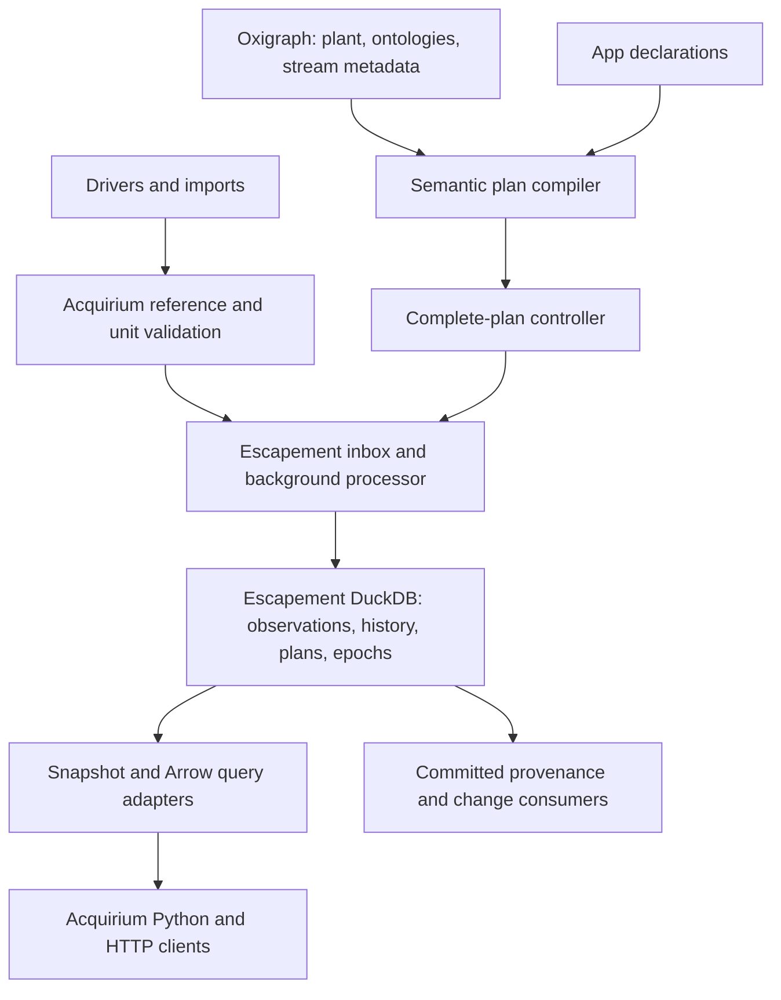

# Make Escapement the core of Acquirium

Status: initial mandatory replacement implemented on this branch; operating-scale validation remains.
Updated on 2026-10-18 on branch `plan/escapement-core`.

## Implementation progress

The initial numeric replacement is implemented: required pinned dependency,
one native owner, raw mutation/history/snapshot transport, semantic app
compilation and durable activation intent, and removal of the old stores,
publication layer, scheduler, and Timescale/Grafana services. Public APIs,
drivers, examples, and configuration now follow the native contract.

Tests exercise native paging/precision/retries, semantic query discovery,
metadata repair, app chains, invalid-plan rollback, paused artifact recovery,
and restart. A real `aq.init()` server test covers a native Python function,
DataObject reads, corrections, deletion, and restart. The current Escapement
revision suffices for this slice; future native API changes are explicitly in
scope, including stream statistics, bulk Arrow exchange, richer windows/values,
and controlled failed-prefix recovery. The soft-sensor authoring and execution
slice below is implemented, including a runnable chain and integration coverage.
Step 4's representative operating-scale measurements and release/CI native
packaging remain subsequent work.

## Continuous workload slice

The [streaming workload](../../examples/streaming/README.md) now drives the native
soft-sensor chain continuously through HTTP. Its source-owned journal preserves
requests before delivery, and its consumer-owned projection atomically saves
complete epochs with their cursor. Acquirium exposes the native signed feed with
bounded pages, a captured publication frontier, and explicit epoch completion;
no second feed ledger or server timeseries store is introduced.

Client ingestion supports immediate durable admission (`wait=0`) and an HTTP
timeout; admission pressure returns retryable 503 responses. Status exposes
server process peak RSS alongside native frontiers/backlog. The harness reports
observed publication/consumption latency bounds, runs bursts and graceful
restarts, and compares all current source/derived results with an independent
source-journal recomputation and a pinned server snapshot. Tests also cover lost
responses, offline delivery, partial-epoch consumer restart, sink write failure,
and abrupt server termination after acceptance.

Initial 60-request/restart and 120-request/steady runs pass full verification.
These are smoke measurements, not a sustained capacity guarantee. Broker-specific
acknowledgments, storage/retention bounds, and longer operating-scale experiments
remain subsequent work. The standalone source driver does not replace the
existing Ray supervisor or claim durable buffering for other drivers.

## Native soft sensors

Implemented in [the tank-temperature chain](../../examples/soft_sensors/README.md)
and [authoring guide](../how-to/write-soft-sensors.md). Output declarations now
support app-owned semantic group attachments; the client exposes native retry;
empty range reads preserve their Arrow schema. Real-server integration tests
compare the complete Python DAG with independent recomputation through late data,
corrections, deletion, metadata moves, parameter/code versions, and restart. A
second test verifies worker subprocesses, atomic failure, and dependency repair
followed by retry. Hermetic bundles, per-app environments, and worker pooling
remain native Escapement extensions rather than promises of this slice.

Use Escapement's [live example](../../escapement/examples/live/README.md) as the
reference: semantic room membership feeds fixed-bucket means, which feed a
pointwise hottest-room function and an alarm. Its
[DAG declaration](../../escapement/examples/live/dag.py) and
[Python calculations](../../escapement/examples/live/transforms.py) already
demonstrate the intended separation. The bridge documentation contains older
dual-store/cutover suggestions; those do not apply to this mandatory replacement.

The implemented slice follows these requirements. Packaging extensions and more
complex domain algorithms remain driven by concrete workloads:

1. Bring the live chain into Acquirium using semantic `Selection` declarations,
   grouping, output metadata, and ordinary client ingestion/reads. Exercise the
   derived metadata needed for downstream discovery, including entity membership;
   extend the declaration if attaching outputs to their semantic group requires it.
2. Make the authoring contract explicit: pure `(frame, context) -> {port: frame}`
   functions, declared roles, frozen units/parameters, pointwise/fixed-bucket
   windows, and complete group results. Empty results retract prior values.
   External notifications consume published changes outside the calculation.
3. Keep Python execution in Escapement. Its current executor launches one child
   process per affected operator per epoch, imports the function once, and
   evaluates the epoch's affected groups through Arrow files. Independent
   operators can run in parallel. Acquirium must not recreate an app runner.
4. Define reproducible deployment of calculation code, helper modules,
   dependencies, and model artifacts. The current single-file digest and shared
   interpreter are a starting point; extend Escapement's artifact/environment API
   where needed. Add worker pooling only after measuring startup overhead, keeping
   results independent of process lifetime and prior invocations.
5. Validate the whole chain through late data, corrections, deletion, metadata
   moves, restart, worker failure and retry against independent recomputation.
   Then port a representative domain soft sensor. Identify required rolling or
   stateful computations explicitly and implement their semantics in Escapement.

**Acceptance:** a runnable Acquirium soft-sensor chain and authoring guide, with
native subprocess execution and repeatable results through historical repair and
restart. No old transform API, polling app loop, or separate execution store.

## Mandatory direction

Escapement becomes Acquirium's **only timeseries engine and store**. Its embedded
DuckDB database owns raw observations, corrections, deletions, derived values,
history, computation progress, and atomic publication. Escapement is a required
dependency, used by every server and local runtime.

Acquirium becomes the semantic and application layer: graph modeling/inference,
semantic queries, stream metadata, unit resolution, drivers, deployment intent,
and HTTP/Python access. Keep these capabilities where they add value; remove
Acquirium's duplicate storage, scheduling, and publication machinery.

There is no backward-compatibility requirement. Remove Timescale support and the
existing Acquirium DuckDB timeseries implementation. Change public APIs,
configuration, app authoring, schemas, and tests to fit Escapement. No alternate
backend, opt-in mode, legacy scheduler, dual writes, migration outbox, or SQL
projection is part of this replacement. Start new deployments with a fresh core
database. Existing data is not deleted automatically; importing it is a separate,
optional future task rather than a release prerequisite.

This is a mandatory architecture change delivered in implementation increments,
not a gradual rollout that keeps the old implementation available.

## What the replacement simplifies

| Responsibility | Result |
| --- | --- |
| Observation persistence and version history | Escapement alone |
| Durable admission, receipts, retry policy | Native Escapement contract |
| DAG validation, dependency execution, affected-group repair | Escapement alone |
| Atomic source/derived publication and restart progress | Escapement epochs and inbox |
| Semantic discovery, ontology inference, stream descriptions | Acquirium/Oxigraph |
| Query results to explicit operator inputs | A small Acquirium compiler |
| Multiple app declarations to one complete active plan | A small serialized Acquirium controller |
| Arrow/HTTP transport and semantic query results | Thin Acquirium adapters |

The simplification is measured by deleted responsibilities and code. An
`EscapementStore` that recreates `TimeseriesStore`, an `EscapementPublisher` that
retains a second receipt model, or an adapter that emulates the old materializer
would defeat the purpose.

## Evidence from the explored code

| Repository | Examined revision |
| --- | --- |
| Acquirium | `ef083dc23e667c1ab65381f2b547ce97136c1815` |
| Escapement | `fe7e50f483a07088a682935e83b6d7095760e1cb` |

The local `escapement -> ../escapement` symlink is an existing untracked development
aid, not a package dependency. Escapement's
[`AcquiriumProcessor`](../../escapement/python/escapement/acquirium.py) already
provides numeric ingestion, background execution, snapshots, Arrow reads,
receipts, and provenance. Its [API contracts](../../escapement/docs/reference/api.md)
and [bridge reference](../../escapement/docs/reference/acquirium.md) describe
limits. The bridge's references to `Apps/runner.py` predate this Acquirium checkout,
which uses `Materialization/*` and `App.transform(inputs, output, context)`.

Useful code to extract rather than preserve wholesale:

- [`BindingPlanner`](https://github.com/DataDrivenCPS/acquirium/blob/ef083dc23e667c1ab65381f2b547ce97136c1815/src/acquirium/Materialization/planner.py): semantic query
  resolution, grouping, and stream descriptors. Keep the query-to-input logic;
  replace the legacy Binding/Deployment execution model.
- [`Manager`](../../src/acquirium/Server/manager.py): registration, reference
  resolution, graph operations, and units. Reduce it to coordinating the graph,
  one core owner, and the semantic plan controller.
- [`Server/app.py`](../../src/acquirium/Server/app.py): lifecycle and transport.
  Replace materialization polling with the native background processor.

## Target architecture

One server process owns one Escapement database and the embedded graph. Drivers
submit observations through Acquirium; they do not open the core database.
`aq.init()` uses the same server lifecycle. Ray may continue supervising existing
drivers during this work; it has no role in computation scheduling. Replacing
Ray is independent of replacing the timeseries core.

Keep `compute_ref_uri(source_id, ref_name)` as a useful canonical identity helper,
not as a compatibility obligation. Use external references as core stream keys;
a point URI can describe several references. Keep stream descriptions in RDF
with a rebuildable in-memory lookup, rather than a second SQL streams/ref_ids
registry. Design output identities around stable app/group/port identities so a
group's membership can change without unnecessarily renaming its output.

Acquirium needs durable **deployment intent**, not another execution database.
Start with a small atomically replaced declaration manifest under `data_dir`,
containing the app registry and pending complete-plan declaration/identity. The
engine owns accepted/active plans and progress. Reconcile pending intent with
native receipts and the committed plan after restart. Do not persist independent
consumed frontiers, binding generations, work queues, or shadow epoch counters.
Use durable file replacement semantics for the manifest, including synchronization
and crash recovery; an in-memory registry or an unprotected JSON overwrite is
insufficient.

An observation epoch does not atomically commit Oxigraph metadata. Record the
graph generation used to compile a plan and expose desired versus active state.
Initially promise coherent timeseries snapshots with identified plan/graph
provenance, not a cross-database transaction over graph and data.

## Adopt the native model; reduce the initial feature set

No legacy behavior must be emulated. The first complete replacement supports the
following deliberately smaller contract:

| Area | Required new behavior |
| --- | --- |
| Values | Finite non-null numeric observations. Reject text, booleans, nulls, and nonfinite values before admission. No text fallback store. |
| Time | UTC nanoseconds; half-open ranges throughout. No microsecond compatibility casts or inclusive-window adapters. |
| Keys | One value per stream and timestamp initially: sample key zero. Require operator outputs to follow this restriction. |
| Ingestion | Explicit upserts/deletes with stable source/request IDs. Use native receipts and the documented bounded retry window. |
| Publication | Durable acceptance and committed visibility are separate. Return a receipt; expose wait/read-after. Timeout after acceptance means pending, not rejected. |
| Bulk writes | Reject requests outside native row/byte bounds. Explicit chunked imports have per-chunk admission, not whole-import atomicity. |
| Reads | Native snapshots/epoch tokens, Arrow ranges, and version history. Complete paging with explicit limits; never silently truncate at the bridge's 10,000-row default. |
| Operators | Pointwise and fixed buckets with native timestamp anchoring. Every port is returned; empty outputs retract old group results. |
| Activation | Complete plans; normal native historical recomputation. No legacy `backfill=False`, `batch_delay`, or `min_interval` behavior. |
| Metadata | Recompile explicit input/context lists on relevant graph changes. Historical repair by default; prospective validity intervals can be added explicitly later. |
| Code changes | Immutable operator versions; native rebuild on redefinition. No old progress-key or explicit-reprocess compatibility. |
| Removal | Native operator removal clears current outputs while retaining historical versions. Respect permanent stream ownership reservations; use versioned identities when necessary. |
| Failure | One failed operator blocks the whole epoch and pauses the processor. Expose that state and explicit retry; do not add a parallel failure scheduler. |
| Inspection | Active plan, snapshots, frontiers, backlog, paused error, provenance, and explain. No SQL progress tables. |

Text/null support, rolling windows, full-history/custom-timestamp computation,
clock-driven outputs, atomic whole-stream replacement, and independent failure
domains are optional **Escapement extensions** if product requirements demand
them. They are not compatibility gates for the initial replacement. Do not
implement missing engine features in an Acquirium side engine. Retire unsupported
examples and clearly reject unsupported declarations/observations.

Remove `replace=True` initially. Explicit bounded mutations are sufficient for
the initial API. If atomic replacement becomes necessary, implement a serialized
native replacement request; snapshot enumeration followed by a later delete batch
is not safe under concurrent ingestion.

Remove the SQL logbook/SQL-query APIs and direct Timescale/Grafana integrations
from the initial supported surface. Operational logging uses normal application
logs. A future persistent domain-event/logbook feature needs its own deliberate
contract; it must not silently keep the old timeseries store alive.

Unit correctness remains required for scientific calculations. Resolve/validate
units in Acquirium and freeze conversion factors into versioned function/input
context before execution. A transform cannot query the live graph or fetch
undeclared history. Start with explicit functions and frozen context; add a native
immutable parameter contract if necessary rather than hidden mutable configuration.

Python functions use Escapement's versioned `(frame, context) -> {port: frame}`
interface and subprocess executor. Acquirium adds semantic selection and output
metadata declarations, not `InputBatch`, `StreamSet`, `OutputBuilder`, or
`TimeWindow` emulation. Pin the user artifact and required helpers/environment;
the digest of a generic adapter alone does not identify its imported calculation.

## Implementation sequence

### 1. Replace persistence and server lifecycle

Make `escapement-db` a normal required dependency, pinned to a reviewed release or
exact Git revision in development and locked. Do not distribute a dependency on
the sibling symlink. Check the native build/wheel matrix for supported platforms.

Open one native processor in Manager/server lifespan. Route all supported
observation writes and reads directly to it. Add receipt/wait/status and coherent
snapshot access. Resolve metadata from the graph; keep the bridge thin and extend
its paging/statistics APIs in Escapement where appropriate. Keep one canonical
observation schema in the transport and core adapter.

Change config to one engine path plus native worker/admission limits. Remove
backend selection, PostgreSQL DSNs, old materialization polling, and alternate
storage initialization. Stop producers and in-flight API callers before closing
the native processor. Pending accepted work must survive restart.

**Acceptance:** mandatory native engine in both server and `aq.init()`; raw
upserts/deletes, receipts, historical reads, and restart work without creating any
legacy timeseries database or starting the legacy materializer.

### 2. Replace app execution with semantic native-plan declarations

Define a small app declaration: semantic input query, grouping, native window,
versioned function, and output metadata. Extract only the reusable query-to-stream
resolution from `BindingPlanner`. Do not preserve the old App transform API.
Compile aliases to roles, references to stream keys, and semantic groups to
operator instances. Keep code/window/output definition versions distinct from
input membership and complete-plan identity.

Use one serialized controller to combine all app declarations into complete
plans. Persist pending intent before admission, reconcile it after restart, and
mark activation complete only after its receipt is published. A deployment must
not accidentally remove operators from other apps. Native validation owns cycles
and output ownership; semantic validation owns selection and units.

Compile against a fresh coherent inferred graph generation; retry if source or
published generations change during compilation. Register structural derived
metadata so downstream semantic queries can discover outputs, then re-resolve
with a bounded stabilization check before activation. Reject declarations that
cannot stabilize. Preserve empty groups or remove their operators deliberately,
so last-member removal retracts current results.

Separate structural output registration from epoch provenance. Structural changes
legitimately affect selection; provenance events must not retrigger planning.
Use an excluded provenance dataset or filtered generation tracking: a separately
named graph alone does not help when every write increments the watched version.

**Acceptance:** two apps and a derived-to-derived chain work; updating one retains
the others; metadata moves repair historical groups; restart restores intent and
active state without another progress mechanism or a graph-refresh loop.

### 3. Prove the smaller system end to end and delete the old core

Rewrite the Fahrenheit-to-Celsius example as a native pointwise function plus
semantic declaration. Add a fixed-bucket aggregate and a downstream function.
Test normal Acquirium registration/query/Arrow paths against independent full
recomputation under corrections, late input, deletions, metadata changes, and
restart. Use explicit epoch tokens for reads across streams.

Delete these old responsibilities, adjusting imports/callers rather than leaving
unused compatibility layers:

- `Storage/duckdb_store.py`, `Storage/timescale_store.py`, the `TimeseriesStore`
  protocol/backend factory, and `Storage/publication/*`.
- `Materialization/revision_store.py`, `scheduler.py`, legacy runtime execution,
  revision/frontier/tombstone/reset tables, and durable repair queues.
- Legacy execution declarations/helpers not needed by the new semantic compiler.
  Replace app checks with isolated native execution if checks remain useful.
- Backend-specific configuration, environment variables, SQL initialization,
  Docker services, and Timescale test fixtures.
- Direct Python `duckdb` and `psycopg` runtime dependencies once their callers are
  removed. DuckDB persistence is supplied by Escapement's bundled Rust dependency.
- SQL logbook, SQL-query, and direct SQL dashboard endpoints/integrations removed
  from the new supported surface.

Update remaining drivers, public APIs, examples, docs, and Docker builds to the
new contract. Numeric observations use the sole ingestion path; drivers producing
unsupported values must reject/configure those streams, never discard them
silently. Retire full-history interpolation until the core supports that workload.

**Acceptance:** no application imports or executes the old stores/scheduler; no
backend flag or fallback path remains; integration tests use temporary native
engine databases. Compare correctness with independent recomputation, not a
permanent second runtime. The PR explicitly accounts for deleted code and reduced
responsibilities as well as added code.

### 4. Establish operating bounds and extend only where needed

Measure expected history, startup/restart memory, correction/backfill cost,
Python worker overhead, and queue latency. The current core keeps all current
relations in RAM and has an unpruned change feed; DuckDB persistence alone does
not make those limits disappear. Set supported workload/admission bounds and
surface capacity failures. Exercise paused-prefix recovery and shutdown, including
failure to drain. Do not promise independent app progress on a global failure.

Prioritize any subsequent typed values, rolling windows, replacement, retention,
schema upgrades, or failure-domain work in Escapement. Acquirium consumes those
capabilities through the same small adapter. No requirement to reimplement all
old features before this mandatory architecture ships.

**Acceptance:** documented and measured workload envelope; visible pending/failed
state; restart/retry correctness and supported native packaging. Additional
features have native contracts and correctness tests before being exposed.

## Validation and first deliverable

During the initial exploration, all 7 Escapement bridge tests and 4 binding tests
passed using its existing installed release extension (0.1.0, macOS aarch64).
These tests cover corrections/retractions, retries, snapshots/history, background
processing, restart, pending work, Python execution, and failure reporting. Rust
sources were inspected but not rebuilt; there is not yet a full-stack integration.

The targeted Acquirium baseline failed before collection because its existing
environment lacks `shifty` (`pyshifty`). Restore the locked environment when
extracting useful semantic/driver tests. Remove tests specific to the discarded
execution model; retain domain invariants and write integration coverage against
the native engine. Passing every old API test is not an objective.

The first implementation deliverable combines steps 1–3 for numeric pointwise and
fixed-bucket workloads: Escapement is required, raw and derived observations live
only in its DuckDB store, semantic apps compile into native plans, and the old
stores/scheduler are deleted. Step 4 validates operating bounds before broader
use. Existing databases and pre-existing untracked user files are preserved.
