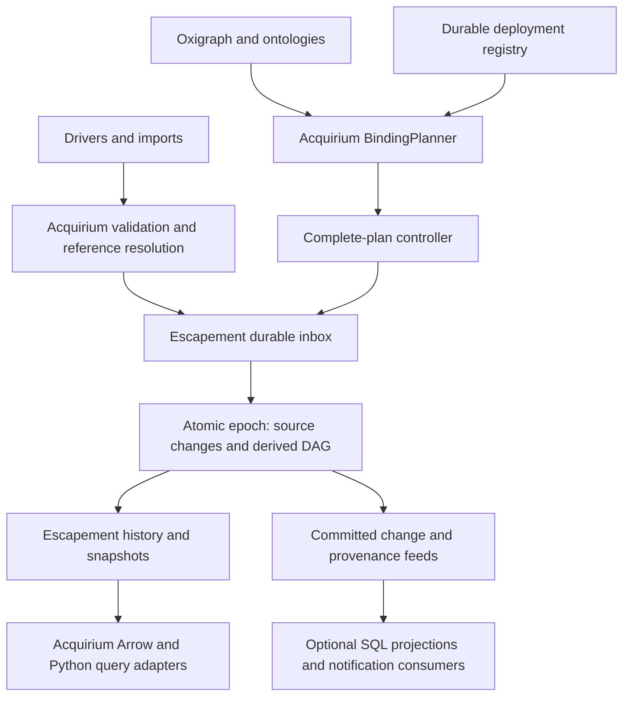

# Make Escapement the core of Acquirium

Status: proposed implementation plan; runtime behavior is unchanged.
Explored on 2026-10-16 on branch `plan/escapement-core`.

## Recommendation

Make Escapement the authoritative engine for observation changes, numeric
history, derived computations, and their publication. Keep Acquirium responsible
for semantic modeling, ontology inference, query authoring, stream registration,
units, drivers, and the HTTP/Python interfaces. Start with an opt-in numeric
vertical slice; expand after closing the compatibility gaps below.

The goal is to replace the revision-based materialization engine, rather than
permanently run two engines that independently own the same streams. Existing
DuckDB/Timescale stores can remain migration sources and optional projections.
Text/null observations need an explicit compatibility stage before Escapement
can become the default for all existing workloads. Logs and control-plane
records can remain in an Acquirium-owned database.

Use the existing Python bridge, not a Rust rewrite of Acquirium. One native
processor belongs to the existing single server process. Ray remains the driver
supervisor; it is not the Escapement executor.

## Evidence and current boundaries

This plan examines the local `escapement -> ../escapement` checkout. That symlink
is an existing, untracked development aid, not a distributable dependency.

| Repository | Examined revision |
| --- | --- |
| Acquirium | `ef083dc23e667c1ab65381f2b547ce97136c1815` |
| Escapement | `fe7e50f483a07088a682935e83b6d7095760e1cb` |

Important Acquirium implementation seams:

- [`Manager`](../../src/acquirium/Server/manager.py) resolves canonical references
  and registered value kinds for individual, batch, and Arrow ingestion. Writes
  converge on `PublicationStore`; whole-stream replacement has a separate method.
- [`PublicationStore`](../../src/acquirium/Storage/publication/types.py) already
  defines canonical Arrow mutations. Its current
  [`RevisionPublisher`](../../src/acquirium/Storage/publication/revision.py)
  does not persist publication identities or deduplicate retries.
- [`BindingPlanner`](../../src/acquirium/Materialization/planner.py) compiles
  deployed queries into explicit reference inputs, metadata context, grouping,
  and stable output identities. Reuse this semantic compilation work.
- [`Materializer`](../../src/acquirium/Materialization/runtime.py),
  [`RevisionStore`](../../src/acquirium/Materialization/revision_store.py), and
  [`scheduler`](../../src/acquirium/Materialization/scheduler.py) currently own
  durable progress, repair windows, output publication, and execution. These are
  the eventual replacement boundary.
- [`TimeseriesStore`](../../src/acquirium/Storage/base.py) also includes stream
  registration, logs, SQL, and transaction hooks. Escapement's bridge is not a
  drop-in implementation of this entire protocol.
- [`Server/app.py`](../../src/acquirium/Server/app.py) owns startup/shutdown and
  the materialization polling task. `aq.init()` starts this same server, so both
  invocation modes should acquire the engine through the same Manager path.

Escapement already implements durable admission, a background processor,
immutable complete plans, affected-group scheduling, atomic source-plus-derived
epochs, correction/deletion history, snapshots, retry receipts, and provenance.
Its [`AcquiriumProcessor`](../../escapement/python/escapement/acquirium.py)
normalizes numeric frames and exports Arrow ranges. The
[bridge reference](../../escapement/docs/reference/acquirium.md) and
[API contracts](../../escapement/docs/reference/api.md) document the boundaries.
The bridge reference mentions an older `Apps/runner.py`; this checkout instead
uses `Materialization/*` and `App.transform(inputs, output, context)`.

## Target ownership



Acquirium retains the graph as the authority for semantic discovery and
`compute_ref_uri(source_id, ref_name)` as the identity rule. Escapement keys are
external `ref_uri`s, never point URIs: one point can have multiple references.
Keep `BindingPlanner.output_port()` identities, including the current
`derived:<application_name>` source convention. Do not copy the older bridge
example's different app-source naming convention.

An epoch makes source and derived **observations** atomic. It does not make an
Oxigraph transaction and a DuckDB transaction atomic together. Record the graph
generation associated with a plan, and report desired/accepted/active plan state
separately. A coherent graph-plus-data client view requires a corresponding
graph-view mechanism; an epoch token alone cannot provide it.

## Compatibility decisions to implement explicitly

| Concern | Current Acquirium | Escapement today | Migration policy |
| --- | --- | --- | --- |
| Values | Numeric and text; numeric streams can contain text fallbacks and null rows | Finite non-null Float64 | Initially opt in eligible streams; preserve legacy streams. Typed values/null semantics gate general cutover. |
| Observation key | `(ref_uri, UTC microsecond)` | `(stream, UTC nanosecond, sample_key)` | Use sample key zero and microsecond-aligned times at the public compatibility boundary. |
| Query ranges | Timeseries HTTP reads use an exclusive end; app `TimeWindow` ends are inclusive | Half-open ranges | Distinguish app windows from fetch ranges. Translate inclusive app ends by one microsecond with overflow checks. |
| Arrow reads | `ts: timestamp[us, UTC], value, uri`; batch iterator; no default row limit | `ref_uri, ts: timestamp[ns, UTC], value`; materialized table; default limit 10,000 | Rename/reorder/cast safely; implement complete bounded paging and statistics. Never silently truncate a client fetch. |
| Replacement | Atomic exact stream contents, including empty replacement | Explicit per-key mutations, no transactional replacement request | Add a serialized native replacement request before moving this feature. |
| Computations | Pointwise, fixed buckets, rolling/context windows, arbitrary output intervals, full history | Pointwise and fixed buckets anchored at group time | Support a declared subset first; add window contracts before migrating the rest. |
| Outputs | Unassigned port preserves data; assigned empty port clears its interval | Every declared port must be returned; empty port retracts old group rows | Require every port in the initial adapter; reject incompatible apps. |
| First deployment | `backfill=False` can skip old observations | Activation can evaluate retained historical groups | Define and persist an initial event-time boundary; never assume equivalent defaults. |
| Metadata changes | Retained-context repairs; inferred graph selection | New complete plan, input event-time validity | Default to historical repair; support prospective interval changes as an explicit policy. |
| Code upgrades | Code changes need explicit reprocessing of old results | Redefined operator activation rebuilds history | Document the changed policy; use shadow generations if upgrades need gradual cutover. |
| App deletion | Removes deployment/progress and retains derived history | Removing operators clears their outputs; output names stay reserved | Separate undeploy, purge, and archive semantics. A compatible archive requires a core ownership/history extension. |
| Failures | Failed binding blocks descendants; healthy branches continue | Failed operator prevents the entire epoch and pauses processing | Expose global pause in experimental mode; independent publication domains require core work before claiming parity. |
| Reprocess/check | Durable interval reprocessing and dry-run API | No equivalent bounded reprocess request in the current bridge | Add explicit reprocess support; dry runs use an isolated temporary engine with no live writes. |
| SQL/Timescale/Grafana | Direct SQL sees the canonical rows | Engine owns a separate embedded DuckDB schema | Provide an optional transactional projection; do not promise direct SQL access to private engine tables. |

Additional contracts:

- Stable request IDs must originate at the client/import job and survive retry.
  `X-Acquirium-Publication-Id` exists for Arrow ingestion; carry identities through
  every transport. Generating a new server UUID after a timeout loses retry safety.
  The Rust retry ledger is bounded (`retry_window` defaults to 100,000 requests),
  so unlimited idempotency needs a durable integration ledger or a documented
  expiration policy. A payload hash alone is not a request identity.
- Admission and publication differ. Preserve existing synchronous visibility
  for compatibility endpoints by waiting on the returned receipt. An explicit
  asynchronous API can return accepted state and a receipt. A timeout after
  admission must report pending status rather than imply that nothing happened.
- The bridge caps a batch at 10,000 input rows; the core also has request-byte,
  selected-row, group, and output bounds. Chunking cannot preserve whole-request
  atomicity. Initially reject oversized atomic batches before admission; add
  staged bulk requests if large atomic imports are required. The existing HTTP
  Arrow handler already commits different sources separately: document that
  boundary rather than imply cross-source atomicity.
- Do not independently commit the numeric and text portions of a batch that
  currently commits together. Keep mixed batches on the legacy route until
  typed admission exists, or offer an explicitly different batch contract.
  A text/null correction at a formerly numeric key must also retract the old
  numeric contribution; dropping nonnumeric rows leaves incorrect derived data.
- The bridge does not convert units. Freeze point/storage units and conversion
  factors into versioned input context/artifacts, validate compatibility before
  activation, and apply the same conversion as current `StreamSet.in_unit()`.
- `source_digest()` and `PythonFunction.from_file()` use different digest
  conventions. Keep deployment identity and native module digest separate.
  Pin adapter code and its imports/environment as well as the user module; a
  wrapper's digest alone does not identify the calculation.

## Implementation sequence

### 1. Package and embed an opt-in engine

Add the `escapement-db` dependency behind an experimental extra initially. Pin a
reviewed release or exact Git revision for development and lock it; do not commit
the local symlink or make installed wheels depend on `../escapement`. Check
Python/Polars/PyArrow compatibility and the native wheel matrix in CI. Escapement
bundles Rust DuckDB 1.4.4 while Acquirium independently imports Python DuckDB;
test coexistence on supported platforms rather than assume they share a library.

Add an Acquirium engine owner and explicit configuration for engine path, worker
count, epoch capacity, and pending-request bounds. Use a separate engine file
from the legacy timeseries/control database. Wire it through Manager and server
lifespan; expose backlog/frontiers/active plan/paused error. Stop producers and
concurrent API callers before draining/closing. Do not run both the legacy
polling scheduler and the native processor for the same output references.

**Acceptance:** embedded open/close/reopen through the server and `aq.init()`,
single-owner enforcement, configuration validation, and recovery of pending work.

### 2. Compile semantic bindings into complete native plans

Reuse `Deployment`, query resolution, grouping, descriptors, output declarations,
and DAG validation. Add a translation layer from `Binding` to `Operator`: input
aliases become roles; references become stream IDs; per-match/all-matches binding
sets determine operator instances. Preserve entity/label/unit context without
making a per-match operator depend on unrelated fleet rows.

Create a durable controller holding the complete desired declaration, immutable
plan ID/digest, graph generation, activation request ID, receipt, and active
state. Serialize deploy/remove/replan requests. Persist intent before submission,
reconcile after restart, and publish active status only after receipt application.
Never treat `activate()` as per-app registration: each activation replaces the
whole plan. Retain last-good definitions when a proposed plan fails validation.
An operator version identifies function/window/outputs/parameters; an input-only
change gets a new plan ID, not an unnecessary definition version.

Resolve against a fresh coherent inferred graph generation, validate source and
published generations before/after compilation, and retry stale work. Derived
output metadata must remain discoverable so downstream queries can bind it;
stage output registrations and re-resolve until the declaration stabilizes, then
validate the complete DAG and activate it. Handle empty input groups explicitly
so the last-member removal clears old outputs.

Separate structural output registration from execution provenance. Structural
metadata legitimately changes discovery; an epoch-provenance mirror must not
invalidate semantic selection on every epoch. Add graph-generation filtering or
an excluded provenance dataset; a separately named graph alone is insufficient
if all writes still increment the same watched generation.

**Acceptance:** two independently deployed apps survive each other's updates;
derived-to-derived selection works; restart reproduces the declaration; graph
changes cannot install mixed-generation inputs or create a refresh loop.

### 3. Prove one complete calculation through Acquirium

Use [`FahrenheitToCelsius`](../../examples/transformation/temperature_conversion.py)
as the first candidate: one numeric pointwise input, explicit arithmetic, stable
per-match outputs, and backfill enabled. Adapt the pure transform to the native
`(frame, context) -> {port: dataframe}` contract. Provide loaded StreamSets and
validated output assignments only if retaining the existing authoring surface;
never give the transform an unrestricted live Manager/client capability.

Feed test observations through Acquirium registration and ingestion, resolve a
real semantic query, activate the operator, and fetch results through the normal
DataObject/Arrow path. Implement numeric read routing and `timeseries_info_batch`
for this slice. Add an epoch token to grouped/multi-stream reads so one DataObject
can use a pinned snapshot across requests; independent HTTP fetches otherwise
can observe different epochs even though each native snapshot is coherent.

Initially compare separate output references with the legacy calculation.
Include fixed-bucket aggregation as the second case. Do not silently adapt
`FillShortTemperatureGaps`: its full-history interpolation emits new timestamps
and needs a different core window/replay contract.

**Acceptance:** end-to-end query and data retrieval agree with independent full
recomputation after late arrivals, corrections, last-row deletion, and restart.
Unsupported window/value/port policies fail during deployment validation.

### 4. Migrate authoritative numeric ingestion

Implement an `EscapementPublisher` at the existing publication seam, with source
scope and receipt state represented explicitly. The current canonical table has
split values and no source column: resolve source ownership in the registry and
restore registered value kinds before calling the numeric bridge. Validate the
whole request before committing, including direct writes to owned outputs.

For a live comparison period, commit normalized mutations and a durable outbox
in the **same legacy-store transaction**. Relay recorded IDs/payloads and
acknowledge durable core admission; do not rely on `_after_canonical_publish()`
or polling current values to discover corrections. Test crash gaps. Bound replay
and ledger retention so an old redelivery cannot resurrect a stale correction.

At numeric cutover, accept numeric changes in the core inbox first and route
reads to its committed snapshots. Any legacy numeric copy becomes a feed
projection, not another writer. Add native atomic replacement before enabling
`replace=True`; computing deletes from a snapshot and submitting later races
concurrent writes. Preserve empty replacements and downstream retractions.

**Acceptance:** crash/retry before admission, after admission, after publication,
and before HTTP response neither loses an acknowledged change nor reapplies an
old correction. No uncoordinated dual writes; replacements serialize correctly.

### 5. Close the gaps needed by current deployments

Implement rolling support with explicit output grids, lookback/lookahead,
affected-group propagation, boundary closure, and deletion of old output groups.
Add full-history/custom-output replay only under an explicit bounded-resource
policy. Port gap filling after that contract exists. Define legacy `backfill`,
`batch_delay`, `min_interval`, reprocess, code-upgrade, omitted-port, and undeploy
behavior; reject unsupported declarations until each has a tested translation.

Extend the core value/schema model for text/null observations if it is to own all
Acquirium timeseries. Preserve value-mode projections and mixed-stream corrections.
Keeping text in a separate store remains a supported transitional mode, but
does not provide one atomic publication across numeric/text observations.

Independent failure domains, controlled recovery of poison work, bounded memory,
history retention, and schema migrations also need core contracts before a broad
default cutover. The current engine keeps all current relations in RAM and its
change feed is unpruned. A queued replacement plan cannot reliably bypass an
already failed prefix.

**Acceptance:** run the relevant existing materialization/value contracts against
the new implementation; document every intentional API change. Measured history,
burst/backfill load, restart memory/time, repair cost, and stalled-queue behavior
must fit real deployment budgets before changing the default.

### 6. Import existing history and retire duplicate machinery

Create a resumable migration command that inventories references, units, value
kinds, deployments, and unsupported apps before writing a new core database.
Import current source state at a pinned cut with deterministic chunk IDs; retain
outbox events after that cut, catch up, and activate the complete plan. Existing
Acquirium rows contain current values, not historical correction versions: do
not manufacture earlier epochs or copy SQL revision frontiers as engine epochs.
Recompute derived values under the selected backfill/upgrade policy and compare
them before transferring output ownership.

Fence legacy writers before the final catch-up/ownership switch. Keep the old
database as a read-only recovery artifact. A rollback after core writes requires
replaying its committed source feed into the old system and reconciling ownership;
changing a configuration flag alone is not a lossless rollback.

Optional Timescale/Grafana projections consume complete signed epochs, apply
retractions and inserts, and commit the feed cursor with sink changes. Pages may
split epochs or retract/insert pairs; stage until an epoch is complete. Report
projection lag and avoid claiming core atomic visibility for a lagging sink.
Notifications consume committed changes outside transforms with consumer-specific
delivery/idempotency rules.

Once migrated workloads pass, remove their legacy `RevisionStore`, scheduling,
frontier/tombstone/reset, and worker publication paths. Retain public query/app
authoring helpers that still add value. Update docs, config, Docker builds, and
integration fixtures around a single authoritative observation engine.

**Acceptance:** resumable import, snapshot comparison, fenced cutover, and a
tested rollback replay on both legacy source backends; no stream has two owners.

## Validation performed during exploration

Using the existing Escapement virtual environment and its installed native
extension (version 0.1.0, release build, macOS aarch64):

```sh
PYTHONDONTWRITEBYTECODE=1 escapement/.venv/bin/python -m unittest discover -s escapement/python -p test_acquirium.py -v
PYTHONDONTWRITEBYTECODE=1 escapement/.venv/bin/python -m unittest discover -s escapement/python -p test_bindings.py -v
```

All 7 bridge tests and 4 binding tests passed, including background processing,
corrections/retractions, normalized retries, pinned/historical reads, restart,
pending work, failure reporting, Python execution, and GIL release. These runs
exercise the installed extension; the Rust code was inspected but not rebuilt,
and no full-stack Acquirium/Escapement integration exists yet.

The targeted Acquirium baseline command was:

```sh
PYTHONDONTWRITEBYTECODE=1 .venv/bin/python -m pytest tests/unit/test_incremental_materialization.py tests/unit/test_storage_values.py tests/unit/test_manager_value_kinds.py -q -p no:cacheprovider
```

It failed before collection because the existing environment lacks `shifty`
(the `pyshifty` dependency). Restore the locked Acquirium environment before
using its suite as the migration baseline. No dependencies, existing data,
runtime code, or sibling Escapement source were changed for this exploration.

## First implementation milestone

Deliver steps 1–3 as one reviewable experimental slice: one server-owned native
processor, complete-plan translation, explicit receipts, and a real
Fahrenheit-to-Celsius semantic-query demonstration with correction and restart
coverage. Then land durable source migration and native replacement in step 4.
Keep the default runtime unchanged until the deployment-specific gaps in step 5
are closed and the migration path in step 6 is validated.
