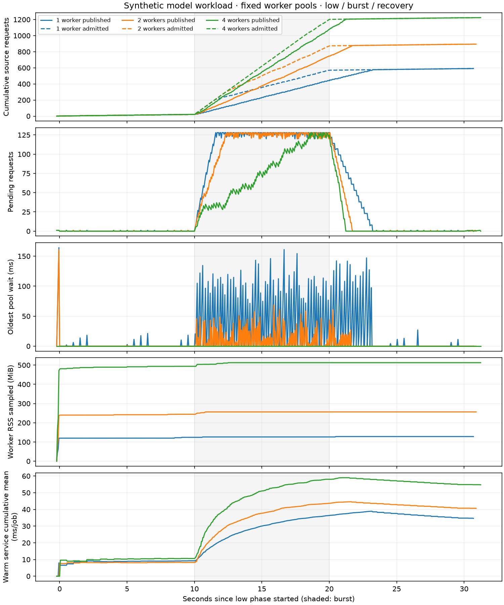

# Native model workload and worker telemetry

Measured on 2026-10-18 with release Escapement
`612eb340974d27ad7245a1c1e4a72e93089bbcc0`, Python 3.12.12, macOS arm64,
eight logical CPUs. These are single sequential runs on a shared developer
machine, not repeated estimates of production capacity. No integration tests ran
during the original five measurements; other applications were not isolated. Environment files
retain each run's native source identity, model hash, and initial load average.

The [benchmark](../../../examples/model_workload/README.md) runs four independent
pointwise soft sensors, each with temperature, conductivity, flow, and pressure
inputs. Every worker loads the same immutable synthetic RBF model once. Its
arrays occupy 10 MiB; process RSS also includes interpreter/libraries and work
buffers. A separate scalar oracle recomputes every current raw and predicted
value, including historical corrections and delete-driven output retractions.

## Fixed pool comparison

Each run has three ten-second phases at requested source rates of 2, 120, and
2 requests/second. Every request affects all four model operators. Native
operator concurrency stays at four, epoch admission batches at eight requests,
and the inbox at 128. Missed source slots are skipped; full admission is retried
with the same ID/payload. Therefore actual offered/admitted rates can fall below
the target under load.

| Pool cap | Burst admitted/s | Burst published/s | Observed publication p95 | Sampled worker RSS peak | Final verified rows |
| --- | --- | --- | --- | --- | --- |
| 1 | 54.8 | 42.7 | 3.121 s | 128.2 MiB | 11,730 |
| 2 | 85.2 | 72.5 | 1.821 s | 256.5 MiB | 17,754 |
| 4 | 118.1 | 105.6 | 1.230 s | 512.7 MiB | 24,296 |

Burst publication rate is `(admitted + pending_before - pending_after) / seconds`
using the native source-request frontier. The p95 covers all accepted requests,
including warmup and final correction/delete, from successful admission to
observing publication. It excludes rejected admission attempts and includes
polling delay, so it is an observed upper bound. All three inboxes reached 128,
backpressured generation, and drained during recovery. Counts differ because
backpressure and skipped slots differ. Every accepted request was observed
published, and every current output passed independent verification.



The burst is shaded; source counts are
solid for publication and dashed for admission. RSS is the sampled sum of root
worker processes, counts shared pages per worker, excludes descendants/server,
and can miss short peaks. The chart includes initialization before time zero.

| Pool cap | Mean groups/job | Mean warm service/job | Service/group | Mean cold start | Peak waiting jobs |
| --- | --- | --- | --- | --- | --- |
| 1 | 5.64 | 34.64 ms | 6.14 ms | 131.22 ms | 3 |
| 2 | 6.12 | 40.61 ms | 6.62 ms | 143.33 ms | 2 |
| 4 | 6.50 | 54.74 ms | 8.41 ms | 146.30 ms | 0 |

Service includes artifact/Arrow preparation and execution through native output
decoding, excluding pool wait and cold initialization. Service/group divides
total cold+warm service by all evaluated groups; it is not an independently
timed function call. All jobs succeeded. Job sizes grow as requests coalesce,
so mean service/job alone cannot size workers. Four workers improve throughput
less than fourfold and increase per-group service in this run. The measurements
do not distinguish CPU, memory bandwidth, file I/O, and contention as causes.

The four-worker run has **zero pool waiters while its source inbox backs up**.
All ready operator jobs already hold leases, and their groups run serially.
Queue age alone would miss this saturation. A later controller must also account
for active jobs, group demand, native backlog, and available DAG parallelism.

## Recycling, persistence, and a narrow operator

The `recycle` run uses two workers, a 25-job recycling limit, three-second phases
at 2/40/2 requests/second, and one drained engine restart after the burst.
It admitted and observed all 135 source requests, verified 2,644 final rows,
and checked identical published state immediately before and after reopening
DuckDB. Across both owners it launched 14 processes and reused workers 276 times;
concurrent reservations never exceeded two. Sampled worker RSS peaked at
252.3 MiB. This tests immutable model reloads and persisted result recovery;
existing native and HTTP tests cover abrupt restart with pending work.

The `narrow` diagnostic uses one operator and a pool cap of four, with three-second
phases at 2/300/2 requests/second. It launched only **one** worker, reached an
inbox backlog of 128, and had zero pool waiters. It published about 158 source
requests/second during the burst, then drained and verified all 617 requests and
3,001 current rows. Its mean job contained 7.26 serial groups. A higher resident
cap cannot expose group concurrency under the present API.

Correction: that initial narrow run also set native scheduler workers to one,
because the harness tied `workers` to `units`. It did not isolate DAG width from
the scheduler limit. The harness now provides a separate `--workers` option.
The corrected diagnostic explicitly sets one
operator, four scheduler slots, and a four-process pool cap. It still launches
only one process, has zero pool waiters, and accumulates pending source requests.
It verifies all 106 accepted requests after draining. This additional run
overlapped integration tests on a busy machine; its latency/rate numbers are
recorded as evidence, not a comparable capacity measurement. The comparison
figure shows only the original five cases.

Many independent device pipelines can already expose operator concurrency.
Group splitting is therefore conditional on a representative narrow-operator
bottleneck, as explained in the [scheduling investigation](../../plans/parallel-group-execution.md).
Batched Arrow/function APIs remain a separate optimization to profile rather
than infer from these totals.

These short runs establish measured behavior for this synthetic workload. They
do not establish leak freedom, long-duration memory bounds, trained-model
accuracy, crash-safe source delivery, or a universal worker recommendation.
Automatic scaling and stateful operators remain future work.

## Reproduction and retained evidence

```sh
uv run --locked python -m examples.model_workload.run \
  --output /tmp/model-pool1 --pool-size 1 --duration 10 --rates 2 120 2
uv run --locked python -m examples.model_workload.run \
  --output /tmp/model-pool2 --pool-size 2 --duration 10 --rates 2 120 2
uv run --locked python -m examples.model_workload.run \
  --output /tmp/model-pool4 --pool-size 4 --duration 10 --rates 2 120 2
uv run --locked python -m examples.model_workload.run \
  --output /tmp/model-recycle --pool-size 2 --duration 3 --rates 2 40 2 \
  --max-jobs 25 --restart
uv run --locked python -m examples.model_workload.run \
  --output /tmp/model-narrow --pool-size 4 --units 1 --duration 3 --rates 2 300 2
uv run --locked python -m examples.model_workload.run \
  --output /tmp/model-narrow-workers4 --pool-size 4 --units 1 --workers 4 \
  --duration 3 --rates 2 300 2
uv run --locked python -m examples.model_workload.plot \
  /tmp/model-pool1 /tmp/model-pool2 /tmp/model-pool4 --output /tmp/model-comparison
```

The raw measurements are not kept in the repository. Rerun the commands above to
regenerate them. Each run writes `environment.json`, `result.json`,
`samples.csv`, and compressed `samples.jsonl.gz`, `epochs.json.gz` and
`requests.jsonl.gz`; the plot command reads them. The full timing histograms use fixed percentile upper bounds; see
[telemetry definitions](../../reference/http-api.md).

Validation passed: 35 native tests, 12 real Python-worker tests, 25 Python API
tests, and nine Acquirium integration tests covering soft sensors, HTTP status,
streaming recovery, native runtime, actual-worker profiling, and the new model
workload. Native Clippy and Ruff on the changed Python files also passed.
