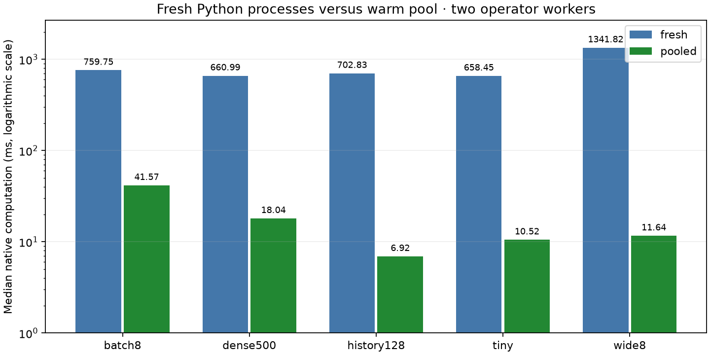

# Persistent worker pool — 2026-10-18

Escapement now owns a bounded pool of persistent pure Python workers. The
temperature chain reuses imported modules across entrypoints and epochs, with
separate replicas for independent ready operators. Acquirium pins native revision
`83fdccbac99e409c193c51b0aa95b67558998ee2` from the
[feature branch](https://github.com/gtfierro/escapement/tree/feature/python-worker-pool).
See the [implementation design](../../plans/escapement-python-workers.md) and
[authoring contract](../../how-to/write-soft-sensors.md).



## Controlled comparison

Both modes use the **same final native revision**, Python calculations, fixtures,
and two active operator workers. Each mode runs five scenarios with paired
instrumented/control cases and five measured epochs, totaling **100 verified
epochs and 260 measured instrumented invocations**. Activation and history-seeding
warmup are excluded. Every epoch's complete source/derived results match an
independent recomputation. The pooled mode permits two resident processes;
fresh mode uses `python_pool_size=0` for a diagnostic control.

Uninstrumented median native computation time, milliseconds per epoch:

| Scenario | Fresh processes | Warm pool |
| --- | ---: | ---: |
| Two tanks, one bucket (`tiny`) | 658.45 | 10.52 |
| Eight requests/buckets (`batch8`) | 759.75 | 41.57 |
| Eight independent tanks (`wide8`) | 1341.82 | 11.64 |
| 500 samples/probe/bucket (`dense500`) | 660.99 | 18.04 |
| Repair one of 128 buckets (`history128`) | 702.83 | 6.92 |

These fixtures show substantially lower repeated execution cost. The small case
is about 63× lower in this run; that ratio is not a prediction for arbitrary
models or application throughput. Every pooled case launched exactly two workers,
with 22 warm leases (58 for eight tanks), zero failures, and zero recycling.
All 130 measured pooled worker profiles were warm and recorded zero library
import time. For `tiny`, actual instrumented function-call means were 0.59 ms
fresh and 0.16 ms warm; imports were 153.47 ms fresh and zero warm. Reuse also
amortizes first-use library and Arrow setup, beyond module imports alone.

The machine was not isolated: initial load averages were recorded in each
environment file, other project tests were active, and the steady HTTP workload
overlapped the pooled sweep. Five samples limit fine comparisons. Instrumented
versus control compute deltas range from −7.8% to +33.2% for fresh and −38.6% to
+176.7% for pooled cases. Interpret sub-millisecond components and small worker
scaling differences cautiously; inspect min/max and individual epochs in the
retained data. The large initialization-versus-reuse difference is supported by
both the timings and measured absence of repeated imports.

This profiles native epoch service, excluding HTTP, producer/consumer work,
queue waiting, and batch-fill delays. Operator wall times can include waiting
for a pool lease and cannot be summed to infer parallel epoch latency. The
external/unattributed residual is not a pure startup or transport measurement.
Warmup excludes initial cold starts; live runs below retain that initial cost.

## Streaming workload

The 120-request steady workload uses bursts of four every 0.05 seconds and
128-row change-feed pages. It independently verifies all 266 final source/derived
rows in both the native snapshot and consumer projection. Publication and
consumption reached the same epoch, 110, with no delivery retries or failures.
Exactly two workers served 375 invocations: two cold starts and 373 warm leases.
Peak observed pending requests was eight. Observed publication latency upper
bounds were p50 35.93 ms, p95 135.82 ms, and maximum 199.67 ms; consumption p95
was 234.67 ms. These bounds include polling and source/client work.

The [steady report](steady-workload.json) retains the complete metrics. Server
peak RSS was approximately 745 MiB and **excludes Python worker processes**.
Warm workers retain memory between invocations; these results do not establish
total memory savings. Age/job recycling bounds reuse lifetime, not peak RSS.

The [restart report](restart-workload.json) covers 60 requests, three graceful
server/consumer restarts, and seven-row feed pages. All 138 final rows match;
both frontiers reach epoch 39, with no delivery retries and peak backlog eight.
Publication p95 is 6.64 seconds and consumption p95 8.60 seconds: these upper
bounds include server startup and periods when polling cannot observe commits.
The final native owner has no new computation after the last restart, so its
pool counters are zero; counters do not aggregate across owners.

## Verified behavior and limits

Native tests cover module reuse across entrypoints, bounded replication under
eight scheduled operators, new artifact versions, digest revalidation, age/job
recycling, fresh controls, and close/reaping. Failure tests cover warm exceptions,
crashes, timeouts (including forked children), log overflow, malformed results,
nonfinite values, and malformed protocol replies. Failed epochs preserve the
old snapshot/frontier and receipt; retry uses fresh workers. Unix process-group
cleanup prevents forked children from holding reply pipes open during teardown.

The native engine suites and 11 real Python-worker tests pass, as do 25 Python
API tests. Acquirium's semantic chain, configuration of a separate resident bound,
warm failure/retry, historical repair, streaming recovery, and abrupt restart
checks pass with the locked dependency. Broader coverage exercised 854 existing
checks; final targeted integration runs also pass. Integration assertions verify
that imports/PIDs persist across warm jobs and change after failure. The
pre-existing untracked RO example test was excluded. Native Clippy passes with
warnings denied; changed
profiling/integration Python code passes Ruff.

Current limits are deliberate: all Python operators obey the pure contract;
there is no automatic purity detection or stateful checkpoint support. The
pool grows on demand to a fixed resident bound, without adaptive scaling or
group chunking. Groups within one operator invocation run serially. Module
digests and interpreter paths identify reuse; helpers, model assets, and full
dependency environments are not yet hermetic bundles. Native history retention
and operating-scale capacity remain separate work.

## Reproduce and inspect

```sh
uv sync --locked --extra mqtt
uv run --locked python -m examples.profiling.run \
  --output /tmp/pool-fresh --workers 2 --samples 5 --execution fresh
uv run --locked python -m examples.profiling.run \
  --output /tmp/pool-warm --workers 2 --samples 5 --execution pooled
uv run --locked python -m examples.profiling.plot /tmp/pool-warm/summary.json \
  --fresh-summary /tmp/pool-fresh/summary.json
uv run --locked python -m examples.streaming.workload \
  --data-dir /tmp/pool-steady --ticks 120 --burst 4 --interval 0.05
```

Retained [fresh](fresh/summary.md) and [pooled](pooled/summary.md) summary tables,
[fresh](fresh/summary.json) and [pooled](pooled/summary.json) machine-readable
summaries, [fresh](fresh/environment.json) and [pooled](pooled/environment.json)
environments, per-epoch [fresh](fresh/epochs.csv)/[pooled](pooled/epochs.csv)
timings, per-invocation [fresh](fresh/workers.csv)/[pooled](pooled/workers.csv)
timings, and the [standalone SVG](pool-comparison.svg) support inspection.
The harness retains per-case native reports and raw worker profiles in its
selected output directory; temporary databases are removed.
