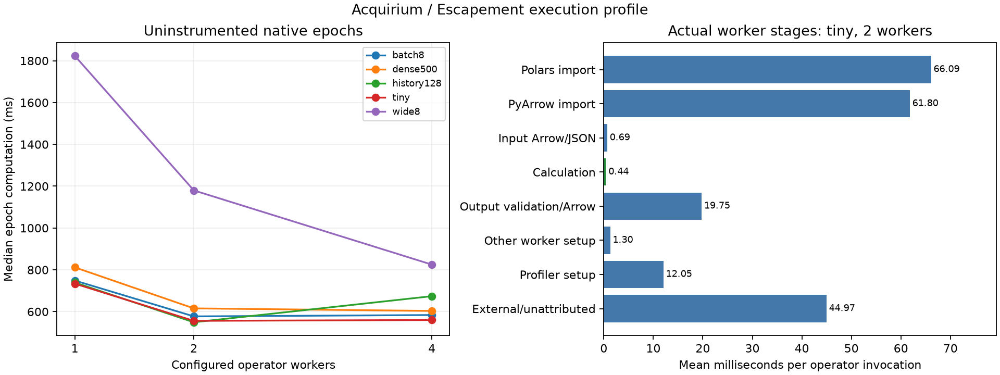

# Python soft-sensor execution profile — 2026-10-18

Follow-up: the [persistent pool is implemented and measured](../2026-10-18-pool/README.md).
The findings below describe the original fresh-process executor.

Repeated Python initialization is the dominant cost in the temperature chain.
Proceed with a persistent, bounded Python worker pool **inside Escapement**;
retain the pure function contract and native atomic publication. The proposed
[worker design](../../plans/escapement-python-workers.md) covers release identity,
reuse, replicas, stateful operators, and later adaptive scaling. Pooling has not
yet been implemented or benchmarked, so these results do not predict its speedup.



## Experiment

The [reusable profiling harness](../../../examples/profiling/README.md) executes
the actual temperature functions through the pinned release Escapement engine.
Five workload shapes × three worker limits × paired instrumented/control cases
× five measured epochs produced **150 verified epochs and 390 instrumented
worker invocations**. Every epoch's complete current source/derived results were
compared with independent recomputation. Activation/history seeding was excluded.

Run on macOS arm64, eight logical CPUs, Python 3.12.12, Polars 1.44.2, PyArrow
23.0.1, and Escapement release `fe7e50f483a07088a682935e83b6d7095760e1cb`.
The machine had background activity (initial load averages 4.32/4.86/4.68).
These controlled native epochs exclude HTTP, graph compilation, producer and
consumer work, live queueing, and batch-fill waiting.

```sh
uv run --locked python -m examples.profiling.run \
  --output /tmp/acquirium-profile --workers 1,2,4 --samples 5
uv run --locked python -m examples.profiling.plot /tmp/acquirium-profile/summary.json
```

## Findings

Uninstrumented median native computation time, milliseconds per epoch:

| Workload | 1 worker | 2 workers | 4 workers |
| --- | ---: | ---: | ---: |
| Two tanks, one bucket (`tiny`) | 733.74 | 555.92 | 559.92 |
| Eight requests/buckets together (`batch8`) | 748.51 | 577.29 | 583.75 |
| Eight independent tanks (`wide8`) | 1823.04 | 1179.71 | 824.98 |
| 500 samples/probe/bucket (`dense500`) | 811.69 | 615.50 | 603.41 |
| Repair one of 128 retained buckets (`history128`) | 739.17 | 549.13 | 673.91 |

The two-tank DAG has at most two ready operators, explaining why four workers
offer little benefit. Eight tanks expose more parallelism: four workers reduce
compute time by about 2.2× relative to one. The history comparison is small and
noisy; it provides no general storage scaling guarantee.

For `tiny` with two workers, means per actual instrumented operator invocation:

| Stage | Milliseconds |
| --- | ---: |
| Standard library + Polars + PyArrow imports | 128.35 |
| Function module/static setup | 0.68 |
| Arrow/JSON input | 0.69 |
| Calculation | 0.44 |
| Output validation/conversion/Arrow writing | 19.75 |
| Final metadata | 0.17 |
| Profiler preparation | 12.05 |
| External and unattributed work | 44.97 |
| Native operator wall time | 207.11 |

Imports account for about 62% of that instrumented operator wall time; calculation
accounts for about 0.2%. Even the dense case averages only 1.74 ms of calculation
with two workers. The residual includes native grouping/serialization/diff,
process launch/exit, completion polling, and report overhead. It cannot be
interpreted as a pure startup cost. Parallel operator wall times are not additive
epoch latency.

Complete fresh-process baselines have medians of 14.38 ms for `pass` and 159.75 ms
for `import polars, pyarrow`; these include shutdown. Batching eight requests
reduces amortized total epoch service cost from 559.41 to 72.41 ms/request at two
workers. That is an amortization measurement, not observed request latency or a
sustainable throughput measurement.

## Limits and retained evidence

Instrumented/control median compute differences range from −14.4% to +28.5%
(+4.4% for `tiny` with two workers). Five samples and background activity limit
small comparisons; profiler overhead is visible. The large import-versus-function
difference is the actionable finding. Output validation/writing is a second
cost to investigate after warm reuse. No results establish benefits for arbitrary
domain calculations, concurrent epochs, or long-running memory stability.

Retained artifacts: [environment](environment.json), [full summary](summary.json),
[summary tables](summary.md), [per-epoch timings](epochs.csv),
[per-invocation timings](workers.csv), and [standalone SVG](execution-profile.svg).
The reusable harness additionally retains each case's native reports and raw
worker files in its chosen output directory. Temporary databases are removed.
