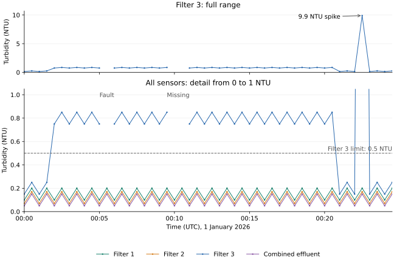

A filter's effluent turbidity rises above its limit. One high reading might be
a bubble past the sensor. Fifteen minutes of high readings means the filter
needs attention. So the alarm we want is not a simple threshold: it has to look
at a stretch of time, cope with bad and missing data, and change its mind when
better data arrives.

This tutorial builds that alarm from two apps. It continues from
[Soft sensor app](first-app.md).

```text
raw turbidity → turbidity-clean → turbidity-alarm
```

The first app cleans each analyser's readings into one value per minute. The
second reads that clean stream and decides whether turbidity has stayed above
the limit for long enough. Each answers one question, and the clean stream is
useful on its own: a report or a second alarm can read it too.

The code is in [`examples/turbidity`](https://github.com/DataDrivenCPS/acquirium/tree/main/examples/turbidity):
`calculations.py` holds the two functions and `apps.py` the declarations. A
short script feeds them twenty-five minutes of readings so that we can follow
every result:

```sh
uv run --locked python -m examples.turbidity.run
```

The script starts a temporary server, loads the data, prints what the apps
produce, and shuts down. It takes seconds, not twenty-five minutes, because
every reading carries the time it was taken.

## Plant and sample readings

Four analysers measure turbidity: one at each filter's outlet and one at the
combined effluent. Each reports a reading every thirty seconds.

Here is part of the input data, before any cleaning. All values are in NTU;
times are UTC on 1 January 2026. A dash means no reading arrived at that time.
`Fault` is the analyser's fault code, reported in place of a number.

| Time | Filter 1 | Filter 2 | Filter 3 | Combined effluent |
| --- | ---: | ---: | ---: | ---: |
| 00:00:00 | 0.10 | 0.07 | 0.15 | 0.05 |
| 00:00:30 | 0.20 | 0.17 | 0.25 | 0.15 |
| 00:01:00 | 0.10 | 0.07 | 0.15 | 0.05 |
| 00:01:30 | 0.20 | 0.17 | 0.25 | 0.15 |
| 00:02:00 | 0.10 | 0.07 | 0.75 | 0.05 |
| 00:02:30 | 0.20 | 0.17 | 0.85 | 0.15 |
| … | … | … | … | … |
| 00:05:00 | 0.10 | 0.07 | 0.75 | 0.05 |
| 00:05:30 | 0.20 | 0.17 | `Fault` | 0.15 |
| … | … | … | … | … |
| 00:09:30 | 0.20 | 0.17 | 0.85 | 0.15 |
| 00:10:00 | 0.10 | 0.07 | — | 0.05 |
| 00:10:30 | 0.20 | 0.17 | — | 0.15 |
| 00:11:00 | 0.10 | 0.07 | 0.75 | 0.05 |
| … | … | … | … | … |
| 00:20:30 | 0.20 | 0.17 | 0.85 | 0.15 |
| 00:21:00 | 0.10 | 0.07 | 0.15 | 0.05 |
| … | … | … | … | … |
| 00:22:00 | 0.10 | 0.07 | 0.15 | 0.05 |
| 00:22:30 | 0.20 | 0.17 | 9.90 | 0.15 |
| 00:23:00 | 0.10 | 0.07 | 0.15 | 0.05 |

We will follow Filter 3. Its readings rise above its 0.5 NTU limit at 00:02
and fall below it at 00:21. Along the way it reports a fault, misses a minute,
and later reports a single 9.9 NTU spike when a bubble passes the sensor.



The plot shows every sample time. Gaps remain gaps; no values have been filled
in. The lower panel enlarges the 0–1 NTU range so Filter 3's sustained rise is
visible alongside the other sensors.

The [plant model](https://github.com/DataDrivenCPS/acquirium/blob/main/examples/turbidity/model.ttl)
connects each stream to its sampling location. The fault code stays in the raw
stream as text; the [values explanation](../explanation/values.md#numbers-and-text)
describes how numbers and text are stored.

## Cleaning function

### Input dataframe

The cleaning app runs once per minute for each location. Each call sees the
readings from five minutes before that minute to five minutes after it. For
Filter 3 at 00:05, the frame holds twenty readings, from 00:00:00 to
00:09:30. Here are four of them, with the `stream` and `context` columns left
out:

| role | time | value | text |
| --- | --- | ---: | --- |
| `"raw"` | 2026-01-01 00:04:30 UTC | 0.85 | `null` |
| `"raw"` | 2026-01-01 00:05:00 UTC | 0.75 | `null` |
| `"raw"` | 2026-01-01 00:05:30 UTC | `null` | `"Fault"` |
| `"raw"` | 2026-01-01 00:06:00 UTC | 0.75 | `null` |

Each row has either a numeric `value` or `text`. The fault code arrives with
`value` null and its code in `text`.

The function's `context["output_time"]` is the minute being cleaned, 00:05.
`context["parameters"]` describes the location:

```python
{"group": ("urn:turbidity:filter-3",), "threshold": 1.0}
```

`group` identifies Filter 3: the app groups readings by location, so Filter 3's
readings never mix with another location's. `threshold` is how far, in NTU,
Filter 3's readings may sit from the median before they count as spikes. The
app declaration gives each location its own.

The cleaning function below declares `frame: pd.DataFrame`, so Acquirium
provides a pandas dataframe with Arrow-backed columns. Its timestamps remain
UTC microseconds; the readings and grouping are the same as in the table.
The alarm function later in the tutorial uses Polars.

### Cleaning steps

The function cleans in four steps:

```python
from datetime import timedelta

import pandas as pd
import polars as pl

from acquirium.functions import emit


def clean(frame: pd.DataFrame, context):
    """One clean turbidity value per minute, from the raw readings around it."""
    t = context["output_time"]

    # Fault codes arrive as text, with no numeric value.
    readings = frame.dropna(subset=["value"])
    # A spike, such as a bubble past the sensor, sits far from the median.
    threshold = context["parameters"]["threshold"]
    median = readings["value"].median()
    readings = readings[(readings["value"] - median).abs() <= threshold]
    if readings.empty:
        return {"turbidity": emit(context, None)}

    # Average the remaining readings within each minute.
    minutes = readings.resample("1min", on="time")["value"].mean()
    # Fill gaps between valid minutes; keep the edges unfilled.
    filled = minutes.interpolate(limit_area="inside")
    # get() returns None for a minute outside the available range.
    return {"turbidity": emit(context, filled.get(t))}
```

1. **Faults.** Rows without a numeric value are dropped. At 00:05 that
   leaves one reading, 0.75 NTU.
2. **Spikes.** The median of ten minutes of readings ignores a few odd ones.
   A reading farther from it than the location's `threshold` is dropped. At
   00:22 Filter 3's median is 0.75 NTU and its threshold is 1 NTU, so 9.9 goes
   and 0.15 stays.
3. **Minute averages.** The remaining readings are averaged within each
   minute. `resample("1min", on="time")` groups readings by their timestamp,
   so 00:02:00 and 00:02:30 make one average at 00:02.
4. **Gaps.** `interpolate()` fills missing minutes along a straight line
   between the nearest valid averages. The minutes are equally spaced.
   `limit_area="inside"` requires a valid value on both sides of a gap.
   At 00:10 both neighbours are 0.80 NTU, so the filled value is 0.80.

`filled.get(t)` returns the value for the output minute, or `None` outside
the range of valid minutes. `emit(context, None)` then returns no reading.
A missing minute needs valid neighbours on both sides within the window;
existing minute averages remain unchanged.

### App declaration

```python
from pathlib import Path
import acquirium as aq

NTU = "http://qudt.org/vocab/unit/NTU"
TURBIDITY = "http://qudt.org/vocab/quantitykind/Turbidity"
MINUTE = 60 * 1_000_000_000
CALCULATIONS = Path("examples/turbidity/calculations.py")

# How far a reading may sit from the median around it before it counts as a spike.
SPIKES = {
    "urn:turbidity:filter-1": {"threshold": 1.0},
    "urn:turbidity:filter-2": {"threshold": 1.0},
    "urn:turbidity:filter-3": {"threshold": 1.0},
    "urn:turbidity:combined": {"threshold": 0.5},
}

raw = (
    client.query()
    .measurement(alias="raw", quantity_kind=TURBIDITY)
    .context(alias="location")
)
clean = aq.App(
    name="turbidity-clean",
    inputs=[aq.Selection.from_query(
        raw, alias="raw", group="location", exclude_app="turbidity-clean",
        parameters=SPIKES,
    )],
    outputs={"turbidity": aq.Output(unit=NTU, quantity_kind=TURBIDITY, on_group=True)},
    function=aq.PythonFunction.from_file(CALCULATIONS, "clean"),
    window=aq.Rolling(lookback_ns=5 * MINUTE, step_ns=MINUTE, lookahead_ns=5 * MINUTE),
)
```

The query finds every turbidity measurement and the location it belongs to.
`group="location"` makes one group per location, so the app runs separately
for each one and needs no list of streams.

`parameters` gives each location its settings, keyed by the location's URI.
The combined effluent normally reads well under 0.3 NTU, so a smaller jump
there is already suspect, and its spike threshold is 0.5 NTU instead of 1.
One function serves every location, and changing one location's value
recalculates only that location's history. Only the listed locations are
cleaned: a fifth analyser needs an entry here too, and deployment warns about
locations the query finds but `SPIKES` leaves out.

The output is declared with `on_group=True`, which attaches the clean stream to
its location as another turbidity measurement. That makes it easy to find, but
it would also match the app's own query. `exclude_app` leaves the app's outputs
out of its inputs.

`Rolling` gives each call five minutes of readings on either side of
`output_time`, at one-minute steps. The spike check needs that context, and so
does a gap fill, which needs an average after the gap as well as before it.
Note what looking ahead implies: a clean value can change when later data
arrives.

## Sustained turbidity threshold

### Group parameters

The alarm's settings are group parameters too. Each location has its own
limit and its own idea of "long enough":

```python
LIMITS = {
    "urn:turbidity:filter-1": {"limit_ntu": 0.5, "sustained_minutes": 15},
    "urn:turbidity:filter-2": {"limit_ntu": 0.5, "sustained_minutes": 15},
    "urn:turbidity:filter-3": {"limit_ntu": 0.5, "sustained_minutes": 15},
    "urn:turbidity:combined": {"limit_ntu": 0.3, "sustained_minutes": 5},
}
```

For Filter 3, the alarm function's `context["parameters"]` is:

```python
{"group": ("urn:turbidity:filter-3",), "limit_ntu": 0.5, "sustained_minutes": 15}
```

Each app sees only its own selection's parameters: the alarm has no
`threshold`, and the cleaner has no `limit_ntu`.

### Alarm function

```python
def alarm(frame: pl.DataFrame, context):
    """1 when clean turbidity stayed above the limit for the whole duration."""
    t = context["output_time"]
    # Report only at minutes that have a clean value.
    if frame.filter(pl.col("time") == t).is_empty():
        return {"alarm": emit(context, None)}

    limit = context["parameters"]["limit_ntu"]
    minutes = context["parameters"]["sustained_minutes"]
    recent = frame.filter(pl.col("time") > t - timedelta(minutes=minutes))
    sustained = recent.height == minutes and recent["value"].min() > limit
    return {"alarm": emit(context, 1 if sustained else 0)}
```

The frame holds clean values, one per minute. `recent` keeps the last fifteen
of them, from 00:02 to 00:16 when `output_time` is 00:16. The alarm is 1 when
there are fifteen and every one is above the limit, and 0 otherwise. The
function does not repeat any cleaning: a missing minute in the clean stream
means a gap the cleaner could not fill, and the alarm does not count it as high.

### App declaration

```python
alarm = aq.App(
    name="turbidity-alarm",
    inputs=[aq.Selection.outputs_of(clean, "turbidity", role="clean", parameters=LIMITS)],
    outputs={"alarm": aq.Output(on_group=True)},
    function=aq.PythonFunction.from_file(CALCULATIONS, "alarm"),
    window=aq.Rolling(lookback_ns=15 * MINUTE, step_ns=MINUTE),
)
```

The input is the cleaning app's output: `outputs_of(clean, "turbidity")` refers
to its port by name, so there is no stream ID to copy, and each location's
clean stream stays in its own group. The window looks back fifteen minutes, the
longest duration in `LIMITS`, and does not look ahead.

## Deployment and output queries

```python
client.deploy_app(clean)
client.deploy_app(alarm)
```

Deploy the cleaning app first, so that its output port exists when the alarm
selects it. The script then inserts the readings and reads both outputs for
Filter 3, asking for the location and the app that produced each one:

```python
filter3 = client.query().entity(uri="urn:turbidity:filter-3", alias="filter3")
clean_values = filter3.measurement(alias="clean", app="turbidity-clean")
alarm_values = filter3.measurement(alias="alarm", app="turbidity-alarm")
clean_values.dataframe().join(alarm_values.dataframe(), on="time", how="left")
```

Here are the results beside the raw readings, with uneventful minutes left out:

| Minute (UTC) | Raw readings | clean | alarm |
| --- | --- | ---: | ---: |
| 00:01 | 0.15, 0.25 | 0.20 | 0 |
| 00:02 | 0.75, 0.85 | 0.80 | 0 |
| 00:05 | 0.75, `Fault` | 0.75 | 0 |
| 00:10 | none | 0.80 | 0 |
| 00:15 | 0.75, 0.85 | 0.80 | 0 |
| 00:16 | 0.75, 0.85 | 0.80 | 1 |
| 00:20 | 0.75, 0.85 | 0.80 | 1 |
| 00:21 | 0.15, 0.25 | 0.20 | 0 |
| 00:22 | 0.15, 9.9 | 0.15 | 0 |

Filter 3 has been above 0.5 NTU since 00:02, counting the filled minute at
00:10, so its alarm comes on at 00:16, fifteen clean values later, and stays on
until the excursion ends at 00:20. The spike at 00:22 never reaches the alarm.

## Late readings and alarm recalculation

Now the readings for 00:10 turn up late, as data from the field often does.
They are 0.15 and 0.25 NTU: Filter 3 briefly dipped below its limit.

The script inserts those two readings and nothing else, and both apps update on
their own. The clean value for 00:10 is now 0.20, a measured average instead of
an estimate. That splits the excursion into two stretches, eight minutes from
00:02 to 00:09 and ten from 00:11 to 00:20. Neither lasts fifteen, so the
alarm is 0 for the whole run.

Only the results that could depend on 00:10 are recomputed: the clean minutes
whose ten-minute window includes it, and the alarm minutes whose fifteen
minutes include those.

That is the right answer, but it raises a question: the alarm *did* fire, and
someone may have acted on it. Acquirium keeps every published version. The
script saved the snapshot number, the epoch, when it first read the alarm, and
reading at that epoch still shows the alarm on for five minutes:

```python
stream = alarm_values.data().stream_info()["ref_uri"][0]
client.stream(stream).dataframe(epoch=first)
```

So you can always tell what the data says now from what it said when a decision
was made.

The alarm in this tutorial is a stored signal of zeros and ones. To send
notifications from it, [consume the committed changes](../how-to/consume-streaming-changes.md),
where you also decide what to do when an alarm is later revised. To split
cleaning into separately reusable stages instead, see
[Data cleaning with multiple apps](../how-to/chain-cleaning-apps.md).
